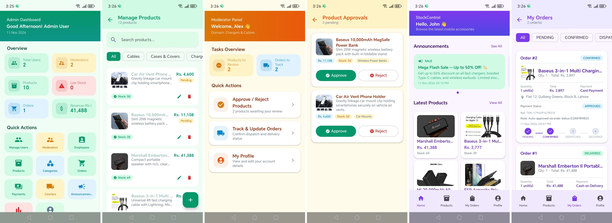

# 📱 Mobile Accessories Stock Control (FYP)

An enterprise-grade, multi-module Android application suite built with **Kotlin**, **Jetpack Compose**, **Hilt**, **Room Database**, and **Firebase Realtime Database** for managing mobile accessories inventory, product approvals, order fulfillment, and customer purchasing.



---

## 🏛️ Project Architecture & Modules

The project is structured into three dedicated Android applications and one shared core library following **Clean Architecture** and **MVVM (Model-View-ViewModel)** patterns:

```
MobileAccessoriesFYP/
├── :admin              # 👑 Admin Management Application
├── :moderator          # 🛡️ Moderator Review & Tracking Application
├── :user               # 🛒 Customer Store & Purchasing Application
└── :core               # 📦 Shared Database, Repositories, Utilities & Components
```

### 1. 👑 Admin App (`:admin`)
* **Dashboard Analytics:** Live overview of active users, moderators, products, low stock alerts, orders, and total revenue.
* **Product & Category Control:** Full CRUD operations for products and categories with instant approval toggles.
* **Order & Payment Management:** Reconciles transactions, processes refunds, updates shipping status, and manages couriers.
* **User Administration:** Creates and manages Moderator and Employee accounts with domain assignments.

### 2. 🛡️ Moderator App (`:moderator`)
* **Product Approval Queue:** Reviews products submitted by users/vendors with **Approve** or **Reject** workflows.
* **Rejection Reason Tracking:** Captures detailed rejection reasons (e.g., low image quality, wrong price) saved directly to Room and Firebase.
* **Order Tracking & Fulfillment:** Monitors active orders, dispatches shipments, and updates delivery statuses.

### 3. 🛒 Customer App (`:user`)
* **Product Catalogue & Search:** Real-time search, sub-category filtering, and category chips for browsing accessories.
* **Instant Order Placement:** Smooth checkout with courier auto-selection, delivery address pre-fill, and payment mode choice.
* **Live Order Tracking:** Step-by-step progress tracking (`PENDING` → `CONFIRMED` → `DISPATCHED` → `DELIVERED`).
* **Profile & History:** Manages delivery details and views full order/transaction history.

### 4. 📦 Shared Core Library (`:core`)
* **Room Database (`AppDatabase`):** Offline-first caching with reactive Flows (`UserDao`, `ProductDao`, `OrderDao`, etc.).
* **Firebase Realtime Database Sync (`ProductSyncHandler`, `OrderSyncHandler`):** Two-way background synchronization.
* **DataStore Session Manager (`SessionManager`):** Encrypted session persistence across app restarts.
* **Adaptive Theme & Components (`AppTopBar`, `StatusBadge`, `ProductCard`):** Unified Material 3 design system.

---

## ⚙️ Custom Firebase & Push Notification Setup

If deploying under a new or custom Firebase project:

1. Place your generated `google-services.json` inside each app module directory (`:admin`, `:moderator`, `:user`).
2. Update the configuration constants in the `:core` shared module:

📍 **File Path:** `core/src/main/java/com/fyp/mobileaccessories/stockcontrol/util/Constant.kt`

```kotlin
object Constant {
    // 1. Realtime Database URL
    const val DATABASE_URL = "https://YOUR-FIREBASE-DATABASE-default-rtdb.firebaseio.com"

    // 2. Firebase Project ID (Required by EasyFirebaseNotifier for FCM push notifications)
    const val PROJECT_ID = "YOUR-FIREBASE-PROJECT-ID"

    // 3. Service Account Private Key JSON (Required by EasyFirebaseNotifier to send push notifications)
    const val SERVICE_ACCOUNT_JSON = """{ ... }"""
}
```

---

## 🔔 Push Notification Integration & Credits

Push notifications across all three Android applications (topic broadcasts & direct user device messaging) are powered by **EasyFirebaseNotifier**.

* 📦 **FCM Notification Library:** [EasyFirebaseNotifier (GitHub)](https://github.com/muhammadnoman11/EasyFirebaseNotifier)
* 👨‍💻 **Author / Maintainer:** [Muhammad Noman (GitHub)](https://github.com/muhammadnoman11)

### Initialization:
`FCMConfig.initialize()` is executed in `AdminApp`, `ModeratorApp`, and `MyApp` during application startup:
```kotlin
FCMConfig.initialize(
    projectId = PROJECT_ID,
    serviceAccountJson = SERVICE_ACCOUNT_JSON.trimIndent()
)
```

---

## 🚀 How to Build and Run in Android Studio

1. Open **Android Studio**.
2. Select **File** → **Open** and choose the root folder `MobileAccessoriesFYP`.
3. Wait for Gradle sync to complete.
4. Choose your run configuration from the target module dropdown:
   * Select **`admin`** to launch the Admin App.
   * Select **`moderator`** to launch the Moderator App.
   * Select **`user`** to launch the Customer Store App.
5. Click **Run (Shift + F10)** on an emulator or connected physical Android device (API 26+).
